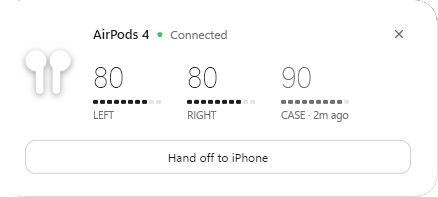
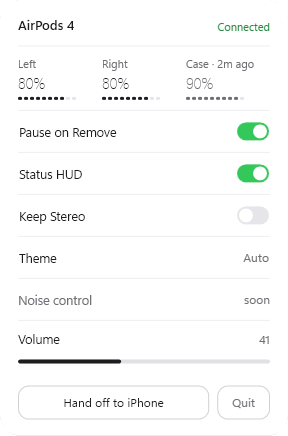
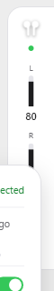

# PodDeck

**AirPods on Windows, the way they should feel.** Open the case and a card pops up with left, right and case battery. A slim HUD keeps the battery on screen, one hotkey moves your AirPods between the PC and your iPhone, and music pauses when you take them out.

[ภาษาไทย](README.th.md)

▶ [Watch the 43-second promo](docs/promo.mp4)

| Lid-open card | Tray panel | Battery HUD |
|---|---|---|
|  |  |  |

## Download

Windows 10 (2004 or newer) / 11, free.

- **[PodDeck.exe](https://github.com/chenlab789/PodDeck/releases/latest/download/PodDeck.exe)**: single file, no install, nothing else to set up

Run it and look for the earbuds icon in the tray (Windows may tuck it under **^**). Windows may show a SmartScreen warning because the file is not code-signed yet. If it does, click **More info**, then **Run anyway**.

## What it does

- **Lid-open card.** Open the case near your PC and a card slides up with left, right and case battery. It hides by itself after a few seconds
- **Battery HUD.** A thin strip on the right edge of the screen. Drag it to the top and it turns sideways; it remembers where you left it. Click it to open the panel
- **Case battery memory.** AirPods only report the case battery while a pod is inside. PodDeck keeps the last value and shows it dimmed with its age, e.g. `CASE · 2h ago`
- **PC ⇄ iPhone in one hotkey.** `Ctrl+Alt+A` connects the AirPods to this PC, or lets go of them so your iPhone can take over
- **Pause on remove.** Take the AirPods out and whatever is playing pauses (YouTube, Spotify, any app that shows media controls); put them back and it plays again
- **Volume.** Drag or scroll the volume bar in the panel
- **Keep Stereo.** Windows switches AirPods to a muffled hands-free mode whenever an app opens their mic. Keep Stereo moves the default mic to another real microphone so the AirPods stay in full stereo. It refuses to pick virtual mics, and puts your old defaults back when you turn it off
- **Dark, Light or Auto** (follows the Windows app theme)
- **Low battery warning** at 20%

| Key | Action |
|---|---|
| `Ctrl+Alt+A` | Connect to this PC / hand off to iPhone |
| `Ctrl+Alt+P` | Show the battery card |

Right-click the tray icon for **Live monitor**, a window that shows in real time what PodDeck hears from your AirPods.

## How it works

No driver, no account, no internet. PodDeck reads the battery and in-ear state from the Bluetooth LE broadcast that AirPods send out anyway, and uses the same Windows audio interfaces as the sound flyout to connect, disconnect and set volume and default devices. Settings live in `%APPDATA%\PodDeck\settings.json`.

## Limits

- **Pause on remove is not instant.** Taking both AirPods out pauses in about 3 to 5 seconds. Taking out only one can take 10 to 20 seconds, because AirPods report the second pod slowly over Bluetooth LE
- **Battery steps of 10%**, which is what the broadcast carries
- **No noise-control switching yet** (ANC / Transparency / Adaptive). That needs Apple's AAP channel, which Windows only exposes to kernel drivers
- **Battery shows only nearby AirPods.** The case must be open, or the AirPods out of the case, within Bluetooth range
- Tested on AirPods 4 (ANC). Other AirPods and Beats models that send the same broadcast should show battery, but are untested

## Build from source

Requires the .NET 8 SDK.

```bash
git clone https://github.com/chenlab789/PodDeck.git
cd PodDeck/src/PodDeck
dotnet run
```

Single-file build:

```bash
dotnet publish -c Release -r win-x64 --self-contained true -p:PublishSingleFile=true -p:IncludeNativeLibrariesForSelfExtract=true
```

The promo video under `promo/` is generated from code (canvas motion graphics, synthesized music and sound effects), see `promo/motion2.html`.

## Credits

The AirPods broadcast format was worked out from community research, notably [OpenPods](https://github.com/adolfintel/OpenPods) and [furiousMAC's continuity notes](https://github.com/furiousMAC/continuity). Volume and device control use [NAudio](https://github.com/naudio/NAudio).

PodDeck is not affiliated with Apple. AirPods and iPhone are trademarks of Apple Inc.

## License

MIT · made by [ChenLab](https://github.com/chenlab789)
