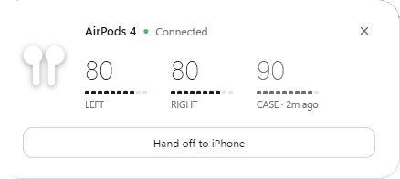
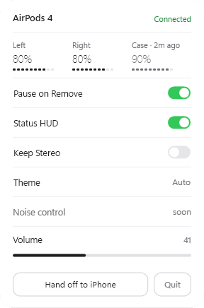
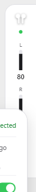

# PodDeck

**ใช้ AirPods กับ Windows ให้รู้สึกเหมือนบน iPhone** เปิดฝาเคสแล้วการ์ดเด้งขึ้นมาบอกแบตซ้าย ขวา และเคส มีแถบแบตเล็กๆ ค้างไว้ขอบจอ กดคีย์ลัดเดียวสลับหูฟังระหว่างคอมกับ iPhone และถอดหูฟังแล้วเพลงหยุดเอง

[English](README.md)

▶ [ดูคลิปโปรโมท 43 วินาที](docs/promo.mp4)

| การ์ดเปิดฝา | แผง tray | แถบแบต (HUD) |
|---|---|---|
|  |  |  |

## ดาวน์โหลด

Windows 10 (เวอร์ชัน 2004 ขึ้นไป) / 11 ฟรี

- **[PodDeck.exe](https://github.com/chenlab789/PodDeck/releases/latest/download/PodDeck.exe)**: ไฟล์เดียว ไม่ต้องติดตั้ง ไม่ต้องลงอะไรเพิ่ม

เปิดแล้วดูไอคอนหูฟังที่ tray มุมขวาล่าง (Windows อาจซ่อนไว้ในลูกศร **^**) ถ้าขึ้นหน้าเตือน SmartScreen เพราะไฟล์ยังไม่ได้เซ็น ให้กด **More info** แล้ว **Run anyway**

## ทำอะไรได้บ้าง

- **การ์ดตอนเปิดฝา:** เปิดฝาเคสใกล้คอม การ์ดจะเลื่อนขึ้นมาบอกแบตซ้าย ขวา และเคส แล้วหายเองในไม่กี่วินาที
- **แถบแบต (HUD):** แถบบางๆ ที่ขอบขวาของจอ ลากไปขอบบนจะหมุนเป็นแนวนอน วางไว้ตรงไหนก็จำไว้ให้ คลิกเพื่อเปิดแผง
- **จำแบตเคส:** AirPods บอกแบตเคสเฉพาะตอนมีหูฟังอยู่ในเคส PodDeck เลยจำค่าล่าสุดไว้ แล้วโชว์เป็นสีจางพร้อมบอกว่าเก่าแค่ไหน เช่น `CASE · 2h ago`
- **สลับ PC ⇄ iPhone ด้วยคีย์ลัดเดียว:** `Ctrl+Alt+A` ต่อ AirPods เข้าคอม หรือปล่อยออกให้ iPhone ใช้ต่อ
- **ถอดหูแล้วเพลงหยุด:** ถอด AirPods ออก เพลงที่เล่นอยู่จะหยุด (YouTube, Spotify และแอปที่มีปุ่มควบคุมสื่อ) ใส่กลับก็เล่นต่อ
- **ปรับเสียง:** ลากหรือหมุนลูกกลิ้งบนแถบเสียงในแผง
- **Keep Stereo:** พอแอปไหนเปิดไมค์ AirPods วินโดว์จะสลับหูฟังไปโหมดโทรที่เสียงอู้อี้ Keep Stereo จะย้ายไมค์หลักไปใช้ไมค์ตัวจริงตัวอื่น เพื่อให้ AirPods อยู่โหมดสเตอริโอเสียงชัดตลอด จะไม่เลือกไมค์เสมือน และตอนปิดจะคืนค่าเดิมให้
- **ธีมมืด สว่าง หรือ Auto** (ตามธีมของ Windows)
- **เตือนแบตต่ำ** ที่ 20%

| คีย์ | ทำอะไร |
|---|---|
| `Ctrl+Alt+A` | ต่อเข้าคอม / ส่งกลับไป iPhone |
| `Ctrl+Alt+P` | เรียกการ์ดแบตขึ้นมาดู |

คลิกขวาไอคอน tray แล้วเลือก **Live monitor** จะเห็นแบบสดๆ ว่า PodDeck ได้รับอะไรจาก AirPods บ้าง

## ทำงานยังไง

ไม่ต้องลงไดรเวอร์ ไม่ต้องมีบัญชี ไม่ใช้เน็ต PodDeck อ่านแบตกับสถานะใส่หูจากสัญญาณ Bluetooth LE ที่ AirPods ปล่อยออกมาอยู่แล้ว ส่วนการต่อ/ตัดหูฟัง ปรับเสียง และตั้งอุปกรณ์เสียงหลัก ใช้ช่องทางเดียวกับเมนูเสียงของ Windows ค่าที่ตั้งไว้เก็บที่ `%APPDATA%\PodDeck\settings.json`

## ข้อจำกัด

- **ถอดหูแล้วหยุดไม่ทันที:** ถอดทั้ง 2 ข้างหยุดใน 3-5 วินาที ถอดข้างเดียวอาจช้า 10-20 วินาที เพราะ AirPods ส่งสถานะของข้างที่ 2 ช้ามากผ่าน Bluetooth LE
- **แบตบอกทีละ 10%** ตามที่สัญญาณส่งมา
- **ยังสลับโหมดตัดเสียง (ANC / Transparency / Adaptive) ไม่ได้** ต้องใช้ช่อง AAP ของ Apple ซึ่ง Windows เปิดให้เฉพาะไดรเวอร์ระดับ kernel
- **เห็นแบตเฉพาะตอน AirPods อยู่ใกล้:** ต้องเปิดฝาเคส หรือหูฟังอยู่นอกเคส และอยู่ในระยะ Bluetooth
- เทสกับ AirPods 4 (ANC) รุ่นอื่นของ AirPods และ Beats ที่ส่งสัญญาณแบบเดียวกันน่าจะเห็นแบตได้ แต่ยังไม่ได้เทส

## Build เอง

ต้องมี .NET 8 SDK

```bash
git clone https://github.com/chenlab789/PodDeck.git
cd PodDeck/src/PodDeck
dotnet run
```

คลิปโปรโมทในโฟลเดอร์ `promo/` สร้างด้วยโค้ดทั้งหมด (โมชันกราฟิกบน canvas เพลงและเสียงประกอบสังเคราะห์เอง) ดู `promo/motion2.html`

## เครดิต

รูปแบบสัญญาณของ AirPods อ้างอิงจากงานวิจัยของชุมชน โดยเฉพาะ [OpenPods](https://github.com/adolfintel/OpenPods) และ [บันทึก continuity ของ furiousMAC](https://github.com/furiousMAC/continuity) การควบคุมเสียงและอุปกรณ์ใช้ [NAudio](https://github.com/naudio/NAudio)

PodDeck ไม่เกี่ยวข้องกับ Apple · AirPods และ iPhone เป็นเครื่องหมายการค้าของ Apple Inc.

## License

MIT · ทำโดย [ChenLab](https://github.com/chenlab789)
